# Datheon Python Programming Internship


Welcome to my repository for the **Datheon Python Programming Internship**!

This repository documents my learning journey and the Python programming projects I develop as part of the internship. The main goal is to strengthen my programming fundamentals, improve problem-solving skills, and gain practical experience by building functional applications.

## About the Internship

Through this internship, I am working on practical Python tasks that help me apply programming concepts to real-world-style problems. Each project gives me an opportunity to practise writing code, debugging errors, organising programs, and improving my understanding of Python.

As a B.Tech Computer Science and Engineering student specialising in Cybersecurity, I believe that strong programming fundamentals are an important foundation for developing future cybersecurity solutions.

### Quick Start (Unified Launcher)

You can launch either project or run the complete automated test suite (81 passing tests) directly from the repository root using the unified launcher:

```bash
python run_project.py
```

CLI options:
- `python run_project.py --doctor`    : Workspace integrity health check
- `python run_project.py --info`      : Runtime environment & repository audit
- `python run_project.py --stats`     : High-level metrics and dataset statistics
- `python run_project.py --summary`   : Consolidated features and metrics snapshot
- `python run_project.py --benchmark` : Run test suites with runtime performance benchmark
- `python run_project.py --lookup TICKER` : Instant S&P 500 company & pricing lookup
- `python run_project.py --check`         : Rapid combined health check and cache clean
- `python run_project.py --clean`     : Safely remove bytecode caches (`__pycache__`)
- `python run_project.py --test`      : Run all automated unit test suites

---

## Projects

### Task 1: Hangman Game
A terminal-based word-guessing game developed using Python featuring an object-oriented game engine, 7 ASCII gallows stages, dynamic word complexity scoring, configurable hint budgets, round telemetry, and automated unit testing.

**Concepts practised:**
- Object-oriented programming & decoupled game logic
- Dynamic word complexity algorithm based on length and rare letter frequency
- Configurable hint budgeting system with usage tracking
- Round duration timer and per-session telemetry history
- Tracking guessed letters, remaining attempts, and guess accuracy ratio
- Automated testing with Python standard `unittest` (32 passing tests)

- 🌟 **[View Task 1 – Hangman Game](./Hangman_Internship_Submission/)**

### Task 2: Stock Portfolio Tracker
A modular Python application designed to record stock purchases and sales, validate tickers against the S&P 500 dataset, track real-time position values, calculate realized/unrealized profit/loss, consolidate multi-lot positions with weighted average cost basis, analyze sector concentration with the Herfindahl-Hirschman Index (HHI), and format customer portfolios into clean ASCII tables.

**Concepts practised:**
- Object-oriented programming & modular service architecture
- Share sale capability with realized gain/loss calculation
- Multi-lot position consolidation with weighted cost basis
- Herfindahl-Hirschman Index (HHI) sector diversification risk profiling
- S&P 500 dataset parsing and ticker validation
- Resilient market pricing engine with standard library fallback
- Unique customer ID generation and persistent file management
- Automated testing with Python standard `unittest` (19 passing tests)

- 🌟 **[View Task 2 – Stock Portfolio Tracker](./Stock_Portfolio_Submission/)**

## Architecture Overview

```mermaid
graph TD
    Launcher[run_project.py CLI Launcher] --> Task1[Task 1: Hangman Game]
    Launcher --> Task2[Task 2: Stock Portfolio Tracker]
    Launcher --> Tests[Automated Test Suite: 72 Tests]

    subgraph Task 1 Engine
        Task1 --> HangmanGame[HangmanGame State Machine]
        Task1 --> WordBank[english_words.txt Dictionary]
        Task1 --> Complexity[Word Complexity Scorer]
        Task1 --> Hints[Configurable Hint Budget]
        Task1 --> Streak[WinStreakTracker & Telemetry History]
        Task1 --> Art[7 ASCII Gallows Stages]
    end

    subgraph Task 2 Engine
        Task2 --> Manager[StockPortfolioManager]
        Task2 --> Sales[Share Sale & Realized P/L Engine]
        Task2 --> Consolidation[Multi-Lot Cost Basis Consolidation]
        Task2 --> Risk[Herfindahl Index Risk Profile]
        Task2 --> Dataset[company_dataset.csv 503 Companies]
        Task2 --> Market[MarketDataService Live/Offline Fallback]
        Task2 --> Ledger[portfolio_summary.csv Ledger]
        Task2 --> Registry[details.txt Customer Registry]
    end
```



## Skills I'm Developing

- Python programming fundamentals
- Logical thinking and problem-solving
- Debugging and error handling
- File handling and data organisation
- Writing structured, readable code
- Using GitHub to document and showcase projects

## Tools and Technologies

- **Language:** Python
- **Version Control and Project Hosting:** GitHub
- **Development Environment:** Visual Studio Code and terminal

## Learning Approach

I believe that practical implementation is an essential part of learning programming. Through these projects, I aim to move beyond understanding concepts theoretically and become more confident in applying them independently.

I am documenting my progress, learning from mistakes, and improving my code one project at a time.

## Acknowledgement

I sincerely thank **Datheon** for providing this internship opportunity and encouraging me to strengthen my Python programming skills through practical tasks.

### System Diagnostics & Health Check

You can run automated workspace verification using the built-in doctor utility:

```bash
python run_project.py --doctor
```

### Project Metrics & Verification Summary

| Component | Task 1: Hangman Game | Task 2: Stock Portfolio Tracker | Unified Launcher Suite |
| :--- | :--- | :--- | :--- |
| **Architecture** | Object-Oriented State Engine | Modular Financial & Market Service | CLI Orchestrator & Diagnostics |
| **Data Source** | 2,492 Curated English Words | 503 S&P 500 Companies Dataset | Subprocess Runners |
| **Test Framework** | Python Standard `unittest` | Python Standard `unittest` | Python Standard `unittest` |
| **Passing Tests** | **51 Passing Unit Tests** | **29 Passing Unit Tests** | **8 Passing Unit Tests** |
| **Total Test Count** | \multicolumn{3}{c|}{**88 Passing Unit Tests Across All Suites**} |
| **Key Features** | 7 Gallows Stages, Phonetic Metrics, Complexity Score | Position Sizing Limits, HHI Risk, Dividend Yield | `--doctor`, `--info`, `--check`, `--clean` |
| **Offline Ready** | 100% Standard Library | 100% Standard Library Fallback | 100% Standard Library |

## Connect With Me

I'm a B.Tech CSE Cybersecurity student interested in Python programming, cybersecurity, and continuous learning.

Thank you for visiting my repository!

**Progress over perfection. Projects over theory.**
